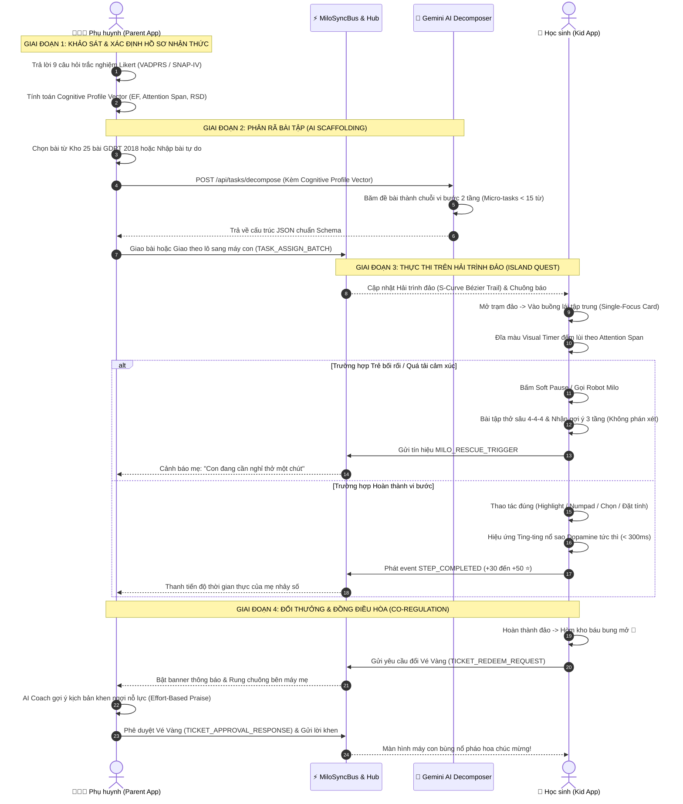
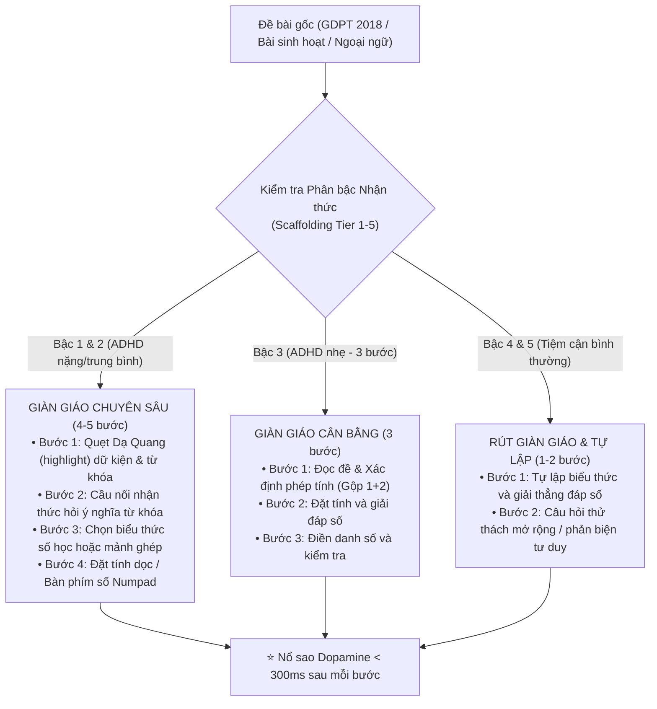
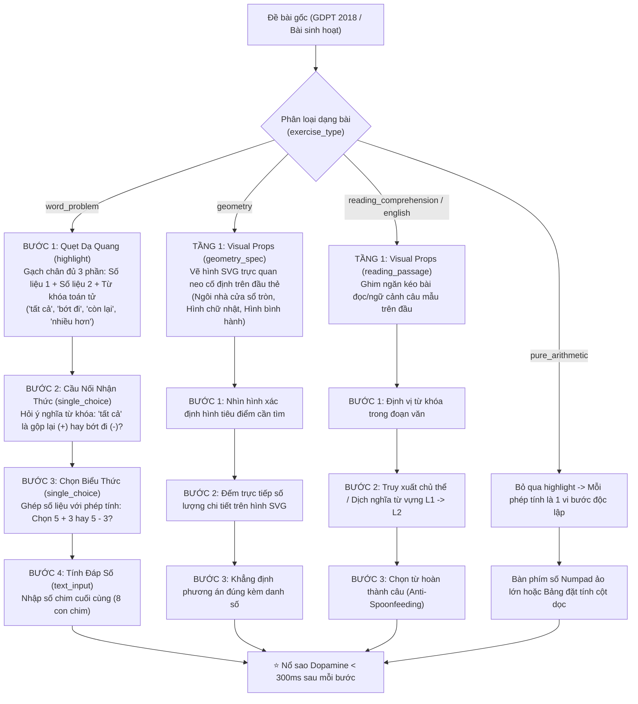
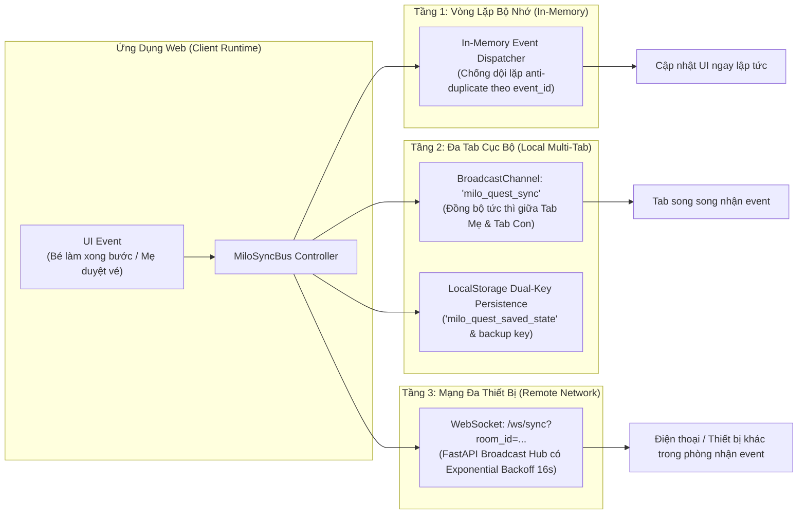

# 🧠 Hệ Sinh Thái AI Can Thiệp ADHD Cho Học Sinh Tiểu Học (Lớp 1–5 GDPT 2018)

> **Dự án**: Nền tảng EdTech can thiệp hỗ trợ trẻ có xu hướng Tăng động Giảm chú ý (ADHD) theo Chương trình Giáo dục Phổ thông 2018 của Bộ GD&ĐT Việt Nam.  
> **Cơ chế cốt lõi**: Phân rã vi nhiệm vụ sư phạm (Micro-Tasks) + Giàn giáo nhận thức thị giác (Visual Scaffolding) + Đồng điều hòa kỹ thuật số thời gian thực (Digital Co-regulation) qua Gemini AI và MiloSyncBus.

---

## 1. Cơ Sở Khoa Học Thần Kinh & Sư Phạm Lâm Sàng

Dự án áp dụng chặt chẽ mô hình Chức năng Điều hành của Russell Barkley, tiêu chuẩn DSM-5, và thang đo lâm sàng Vanderbilt (VADPRS) / SNAP-IV:

```
┌─────────────────────────────────────────────────────────────────────────────────────────────┐
│                                 BẢN CHẤT THẦN KINH CỦA TRẺ ADHD                            │
├──────────────────────────────┬──────────────────────────────┬───────────────────────────────┤
│    Suy giảm Dopamine Thể vân │     Quá tải Trí nhớ Làm việc │  Nhạy cảm Thất bại (RSD)      │
│     (Dopamine Deficiency)    │    (Working Memory Overload) │(Rejection Sensitive Dysphoria)│
├──────────────────────────────┼──────────────────────────────┼───────────────────────────────┤
│ Não bộ chỉ kích hoạt trước   │ Không thể xử lý cùng lúc đề  │ Hạch hạnh nhân (Amygdala) bùng│
│ kích thích thị giác trực quan│ bài dài hoặc hình phức tạp.  │ phát cảm xúc tiêu cực khi bị  │
│ và phần thưởng tức thì.      │ Dễ quên số liệu hoặc nhầm    │ chê hoặc sai. Trẻ nảy sinh phản│
│                              │ chu vi với diện tích.        │ xạ tự ái, bỏ cuộc ngay.       │
├──────────────────────────────┼──────────────────────────────┼───────────────────────────────┤
│ 👉 GIẢI PHÁP:                │ 👉 GIẢI PHÁP:                │ 👉 GIẢI PHÁP:                 │
│ Visual Timer đĩa tròn đếm lùi│ Phổ giàn giáo 5 bậc tự thích │ Robot Milo xoa dịu RSD; Ngăn  │
│ + Pháo hoa nổ sao Dopamine   │ ứng (băm từ 5 bước -> 1 bước)│ kéo bài đọc ghim trên đầu; Bố │
│ tức thời (< 300ms sau bước). │ + Bộ vẽ SVG hình học tại chỗ.│ mẹ gửi lời khen nỗ lực.       │
└──────────────────────────────┴──────────────────────────────┴───────────────────────────────┘
```

> 🌟 **Thuật Toán Hiệu Chuẩn Động Học Thích Ứng (Adaptive Dynamic EMA Calibration)**:  
> Khảo sát 9 câu của Bố Mẹ đóng vai trò là **Baseline Prior (Điểm xuất phát ban đầu)**. Khi trẻ thao tác thực tế trên app, hệ thống tự động ghi nhận 5 chỉ số hành vi khách quan:
> 1. →T_{init}→: Thời gian đóng băng trước thao tác đầu tiên (Task Initiation Latency).
> 2. →N_{err}→: Số lần thử sai, bấm xóa Numpad hoặc đổi đáp án.
> 3. →R_{time}→: Tỷ lệ thời gian hoàn thành thực tế so với định mức Visual Timer.
> 4. →T_{freeze}→: Thời gian đứng hình sau khi làm sai (phản ánh kích hoạt hạch hạnh nhân RSD).
> 5. →N_{rescue}→: Tần suất kích hoạt bài tập thở 4-4-4 và gọi trợ giúp từ Robot Milo.
>
> Dữ liệu được đưa vào thuật toán **Exponential Moving Average (EMA)** với hệ số học →lpha = 0.15→ và chốt chặn Max-Delta →\pm 10\%→ để tự động nâng/hạ cấp bậc giàn giáo một cách mượt mà.

---

## 2. Các Luồng Vận Hành Cốt Lõi (Core Workflows)

### 2.1. Luồng Trải Nghiệm Học Tập & Đồng Điều Hòa Kỹ Thuật Số (End-to-End User Journey)

Toàn bộ quy trình từ lúc phụ huynh định hình hồ sơ nhận thức đến khi trẻ hoàn thành nhiệm vụ và nhận lời khen ngợi diễn ra theo chu trình khép kín:



---

### 2.2. Ma Trận Phân Bậc Giàn Giáo Thích Ứng 5 Cấp Độ (5-Tier Adaptive Scaffolding Spectrum)

Hệ thống không chia nhị phân cứng nhắc mà thích ứng linh hoạt theo **phổ nhận thức liên tục 5 bậc** dựa trên $CDI \in [0.0, 1.0]$ và Sức chứa trí nhớ làm việc $WM \in [1, 5]$:

| Cấp độ | Điều kiện chỉ số | Số bước phân rã | Cấu trúc Toán có lời văn | Cấu trúc Đọc hiểu Tiếng Việt | Cấu trúc Tiếng Anh Tiểu học |
| :---: | :---: | :---: | :--- | :--- | :--- |
| **Bậc 1: Siêu phân rã** *(ADHD nặng)* | $CDI \ge 0.75$<br>$WM \le 1$ | **5 vi bước** | Tách riêng gạch chân số 1 → Gạch chân số 2 + từ khóa → Ý nghĩa từ khóa → Chọn phép tính → Tính toán | Mặt nạ đọc từng dòng (Line mask) → Gạch chân từ khóa dòng đầu → Xác định chủ thể → Chọn ý nghĩa → Chốt đáp án | Phân tách câu thành từng cụm mảnh ghép 2 từ có khớp nối màu sắc (Color Puzzle) |
| **Bậc 2: Giàn giáo cao** *(Chuẩn GDPT)* | $0.55 \le CDI < 0.75$<br>$WM = 2$ | **4 vi bước** | Bước 1: Highlight số liệu & từ khóa → Bước 2: Cầu nối ý nghĩa → Bước 3: Chọn phép tính → Bước 4: Đặt tính dọc | Ghim đoạn văn trên đầu → Gạch chân từ khóa mấu chốt → Dò chủ thể → Trắc nghiệm đọc hiểu | Dịch từ khóa L1 → L2 → Ghép vế khẳng định → Chọn câu hoàn chỉnh |
| **Bậc 3: Cân bằng** *(ADHD nhẹ)* | $0.35 \le CDI < 0.55$<br>$WM = 3$ | **3 vi bước** | Đọc đề và chọn phép tính (gộp highlight + nhận diện) → Đặt tính và tính nhẩm → Kết luận danh số | Bỏ bước highlight mớm ý, đọc lướt văn bản và trả lời câu hỏi đọc hiểu → Trích dẫn chứng | Ghép trọn vẹn câu từ 3 khối cụm từ lớn (3 chunks) |
| **Bậc 4: Tự lập nhẹ** *(Tiệm cận bình thường)* | $0.20 \le CDI < 0.35$<br>$WM = 4$ | **2 bước** | Trẻ tự lập biểu thức và tính đáp số trong 1 card (ví dụ: `15 - 8 = 7`) → Ghi câu đáp số hoàn chỉnh | Đọc hiểu câu hỏi suy luận → Tự viết câu tóm tắt nội dung | Tự sắp xếp toàn bộ câu hoàn chỉnh trực tiếp không cần chia cụm |
| **Bậc 5: Tự chủ & Mở rộng** *(Bình thường / Năng khiếu)* | $CDI < 0.20$<br>$WM = 5$ | **1 bước + 1 thử thách** | Tự giải trọn vẹn bài toán trong 1 card → Thử thách mở rộng tư duy / phản biện | Đọc hiểu độc lập → Câu hỏi cảm thụ / phát triển nhân vật | Sắp xếp câu hoàn chỉnh → Thử thách sáng tạo đặt câu mới |





---

### 2.3. Luồng Đồng Bộ Dữ Liệu Thời Gian Thực 3 Tầng (Tri-Layer Realtime Sync)

`MiloSyncBus` đảm bảo trải nghiệm hai máy hoạt động mượt mà trong mọi điều kiện mạng (kể cả khi mất kết nối mạng Internet):



---

### 2.4. Quy Trình 4 Bước Khi Sửa Hoặc Thêm Dạng Bài Mới (Developer Workflow)

Khi cần tinh chỉnh bài tập hoặc thêm dạng bài mới, bắt buộc tuân theo quy trình đồng bộ 4 bước để đảm bảo không phá vỡ kiến trúc:

```
┌─────────────────────────────────────────────────────────────────────────────────────────────┐
│                       QUY TRÌNH ĐỒNG BỘ 4 BƯỚC CHO DEVELOPER & AI AGENT                     │
├─────────────────────────────────────────────────────────────────────────────────────────────┤
│ 1. SỬA DỮ LIỆU GỐC:                                                                        │
│    Sửa trực tiếp trong data/curriculum/tasks_db.json (Nguồn chân lý duy nhất).              │
│    Tuyệt đối không hardcode dạng bài hay câu lệnh if (taskId === '...') vào app.js.         │
│                                                                                             │
│ 2. KIỂM TRA BỘ RENDER UI:                                                                   │
│    Đảm bảo các trường ui_type, geometry_spec, reading_passage được hỗ trợ bởi               │
│    app/js/renderers.js và app/js/geometry.js.                                               │
│                                                                                             │
│ 3. DẠY LẠI AI (PROMPT FEW-SHOT):                                                            │
│    Copy bài tập mẫu chuẩn mực vừa sửa dán vào mục ## 4. BÀI HỌC MẪU (FEW-SHOT EXAMPLES)     │
│    của prompts/micro_task_decomposer.md để Gemini AI học theo cách băm chuẩn.               │
│                                                                                             │
│ 4. CHẠY KIỂM THỬ XÁC NHẬN:                                                                  │
│    python tests/runner.py                                                                   │
│    Get-ChildItem tests/adversarial/*.js | ForEach-Object { node →_.FullName }               │
│    Tất cả bài test bắt buộc phải đạt 100% GREEN (Zero Regression).                          │
└─────────────────────────────────────────────────────────────────────────────────────────────┘
```

---

## 3. Kiến Trúc Hệ Thống & Single Source of Truth

Cấu trúc thư mục của dự án:

```
calm-bardeen/
├── app/                              # Frontend Web (FastAPI phục vụ trực tiếp tại root /)
│   ├── index.html                    # Giao diện Simulator 2 màn hình (Máy Mẹ & Máy Con)
│   ├── css/
│   │   └── style.css                 # Hệ thống theme, nút bấm 3D xúc giác, độ tương phản WCAG AA
│   └── js/                           # KIẾN TRÚC JAVASCRIPT MODULE HÓA CHUYÊN BIỆT
│       ├── tasks_data.js             # Kho dữ liệu bài tập dự phòng offline (29 bài)
│       ├── audio.js                  # Web Audio API Synthesizer (tổng hợp âm thanh tức thì < 300ms)
│       ├── sync_bus.js               # MiloSyncBus: Đồng bộ 3 tầng (WebSocket + Broadcast + Storage)
│       ├── state.js                  # Quản lý trạng thái phản ứng & Hồ sơ nhận thức (appState)
│       ├── geometry.js               # Bộ vẽ SVG giàn giáo hình học trực quan (renderGeometrySvg)
│       ├── roadmap.js                # Hải trình đảo nhiệm vụ & Đường cong Bézier S-Curve nối đảo
│       ├── renderers.js              # Bộ render vi bước ADHD (Quẹt highlight, Numpad, Cột dọc)
│       ├── rewards_timer_milo.js     # Đĩa đếm lùi Visual Timer, Milo Soft Pause CBT & Đổi Vé Vàng
│       ├── parent_survey.js          # Bảng khảo sát 9 câu VADPRS, Radar Profile & Quản lý danh mục
│       ├── decomposer_fallback.js    # Engine phân rã vi nhiệm vụ client-side khi mất mạng
│       └── app.js                    # Điểm khởi chạy chính & Đồng bộ API tự động
├── data/
│   └── curriculum/
│       └── tasks_db.json             # NGUỒN CHÂN LÝ DUY NHẤT: 25 bài GDPT 2018 + 4 bài sinh hoạt
├── prompts/
│   ├── micro_task_decomposer.md      # NGUỒN CHÂN LÝ DUY NHẤT: Prompt phân rã vi nhiệm vụ AI
│   ├── kid_rsd_calming_milo.md       # Prompt Robot Milo xoa dịu cảm xúc thất bại cho trẻ
│   └── parent_effort_coach.md        # Prompt AI Coach hướng dẫn phụ huynh khen nỗ lực
├── src/
│   └── api/
│       ├── server.py                 # FastAPI Web Server + WebSocket Hub + Static Mount app/
│       └── ai_engine.py              # Gemini 3.5 Flash Lite Live Decomposer Engine
├── tests/
│   ├── runner.py                     # Bộ điều phối test tự động toàn dự án (363 tests)
│   ├── test_api_server.py            # Kiểm thử REST API & WebSocket sync
│   ├── e2e/                          # Bộ kiểm thử E2E tích hợp sâu (225 tests)
│   └── adversarial/                  # 8 bộ kiểm thử Node.js tấn công phá hoại & biên dữ liệu
├── requirements.txt                  # Danh sách thư viện Python phụ thuộc
├── run.bat                           # Khởi chạy 1-click toàn bộ hệ thống
└── AGENTS.md                         # Quy tắc bắt buộc dành cho AI Agent khi lập trình
```

---

## 4. Kiến Trúc Module Hóa Frontend (`app/js/`)

Frontend sử dụng Vanilla JS theo nguyên tắc Đơn trách nhiệm, được nạp tuần tự qua thẻ `<script>` trong `app/index.html`:

| File Module | Số dòng | Trách nhiệm chính |
| :--- | :--- | :--- |
| **`tasks_data.js`** | ~4.010 | Kho bài tập chuẩn hóa GDPT 2018 dùng cho chế độ offline hoặc test sandbox. |
| **`audio.js`** | ~110 | Trình tổng hợp âm thanh Web Audio API (ting ting nổ sao, còi, âm đàn harpe hạ nhiệt). |
| **`sync_bus.js`** | ~520 | `MiloSyncBus`: Đồng bộ 3 lớp (WebSocket Hub →\rightarrow→ BroadcastChannel đa tab →\rightarrow→ LocalStorage fallback). Chống dội lặp, tự kết nối lại có backoff. |
| **`state.js`** | ~210 | Store nhận thức trung tâm (`appState`), lưu trữ/phục hồi localStorage, chuyển đổi profile (`?role=child`, `?role=parent`, `?role=dual`). |
| **`geometry.js`** | ~100 | Bộ vẽ SVG giàn giáo hình học (`renderGeometrySvg`): ngôi nhà đếm cửa sổ tròn, hình chữ nhật, hình bình hành, ao cá trong vườn. |
| **`roadmap.js`** | ~380 | Vẽ hải trình đảo nhiệm vụ trên canvas S-Curve Bézier Spline, rương kho báu, quản lý danh sách đảo phía phụ huynh. |
| **`renderers.js`** | ~1.480 | Bộ render vi bước xúc giác ADHD + Động cơ gộp bước `fuseTaskStepsByTier` (co giãn từ 5 bước xuống 1 bước) + Bộ ghi nhận Telemetry tương tác thực tế (→T_{init}, N_{err}, T_{freeze}→). |
| **`rewards_timer_milo.js`** | ~360 | Đĩa tròn Visual Timer tự động co giãn theo ngưỡng chú ý, Soft Pause giải tỏa áp lực, bài tập thở 4-4-4, đổi Vé Vàng thưởng, tự động kích hoạt cập nhật nhận thức khi hoàn thành bước. |
| **`parent_survey.js`** | ~850 | Bảng khảo sát 9 câu VADPRS/SNAP-IV, thuật toán EMA hiệu chuẩn động học `adaptiveUpdateCognitiveProfile`, phân giải 5 bậc `resolveScaffoldingTier` và cập nhật radar nhận thức thời gian thực. |
| **`decomposer_fallback.js`**| ~690 | Bộ băm bài bằng luật Regex client-side khi backend mất kết nối, hỗ trợ tự soạn bài thủ công. |
| **`app.js`** | ~90 | Điểm gắn kết DOMContentLoaded, khởi tạo bus, gọi `syncTasksFromApi()` tự động đồng bộ bài từ FastAPI. |

---

## 5. Hướng Dẫn Cài Đặt & Khởi Chạy (1-Click Launch)

### Cách 1: Khởi chạy nhanh 1-Click (Khuyên dùng trên Windows)
Double-click vào file:
```cmd
run.bat
```
Script sẽ tự động khởi động server FastAPI tại port 8000 và tự mở trình duyệt Chrome hiển thị giao diện mô phỏng 2 thiết bị song song.

### Cách 2: Khởi chạy thủ công qua Terminal
```bash
# 1. Cài đặt toàn bộ thư viện phụ thuộc
pip install -r requirements.txt

# 2. Khởi chạy FastAPI Server
python -m src.api.server
```
Truy cập ứng dụng tại: `http://localhost:8000/`

---

## 6. Hệ Thống Kiểm Thử Toàn Diện (Test Harness)

Dự án sở hữu bộ kiểm thử tự động đa tầng với kết quả **100% GREEN (Zero Regression)**:

### 1. Test Suite Runner Toàn Diện (Python E2E + Live API)
```bash
python tests/runner.py
```
* **363/363 bài kiểm thử vượt qua thành công** trong ~30 giây.
* Kiểm thử toàn bộ API Server, WebSocket handshake, Live Gemini API Decomposer (kèm retry khi 503 spike).

### 2. Kiểm thử Tích hợp Ứng dụng Kép (Dual App E2E)
```bash
python -m unittest tests/e2e/test_dual_app_e2e.py
```
* **225/225 bài kiểm thử vượt qua 100%**.

### 3. Bộ Kiểm thử Tấn công Phá hoại Node.js (Adversarial Stress Suites)
```powershell
Get-ChildItem tests/adversarial/*.js | ForEach-Object { node →_.FullName }
```
Bao gồm 8 bộ test chuyên sâu:
1. `test_adhd_ui_ergonomics_adversarial.js`: Độ nảy cảm ứng, quy chuẩn công thái học ADHD.
2. `test_challenger_curriculum_ui.js`: Biên dữ liệu 29 bài tập, bão click nút bấm, giới hạn numpad buffer.
3. `test_challenger_storage_cheer_stress.js`: Phục hồi khi LocalStorage bị corrupt, rớt mạng, gửi lời khen.
4. `test_m3_ai_decomposition_interactive_stages.js`: Quy trình tương tác vi bước của trẻ.
5. `test_m4_ergonomics_contrast_themes.js`: Tương phản màu sắc WCAG AA (→\ge 4.5:1→).
6. `test_milo_sync_adversarial.js`: Tải xung đột 50 event/giây trên MiloSyncBus, chống lặp packet.
7. `test_parent_survey_cognitive_profile.js`: Kiểm thử toán học vector nhận thức EF/AS/RSD.
8. `test_whitebox_sync_simulator_adversarial.js`: Luồng duyệt Vé Vàng, chống double-spend điểm thưởng.
